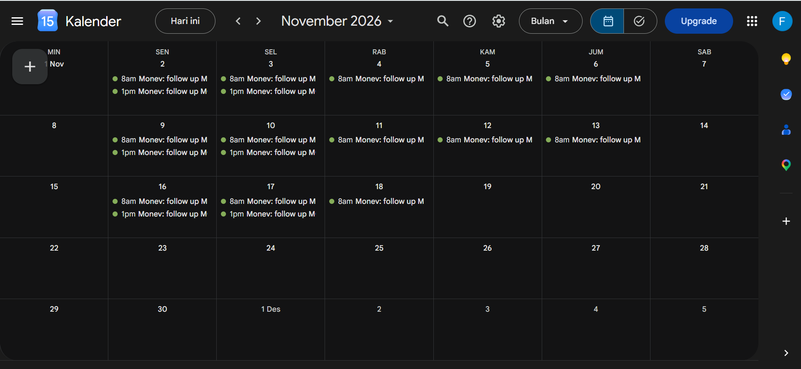
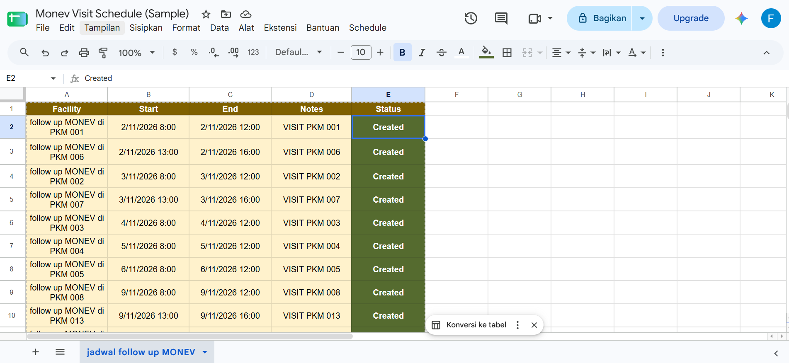
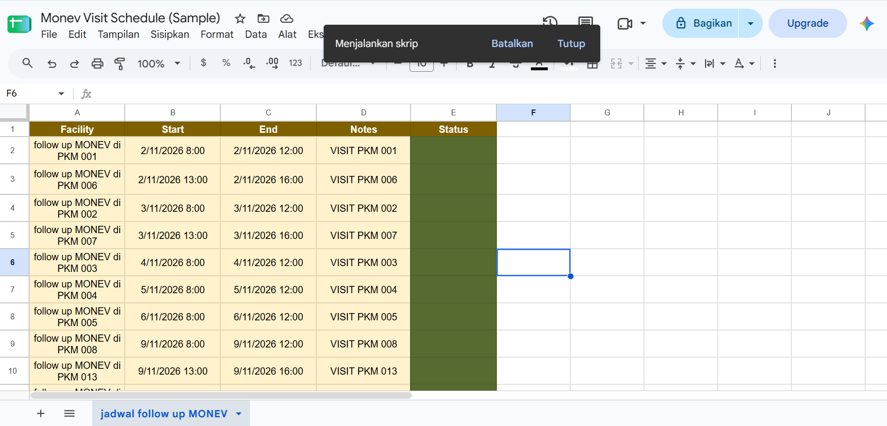
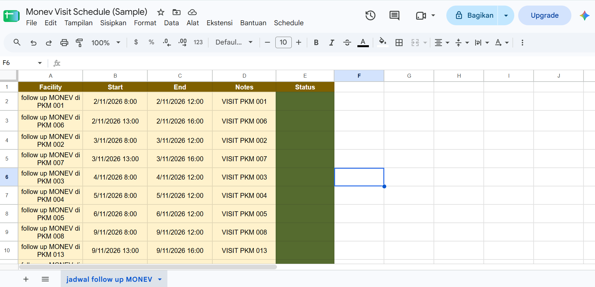

# Monitoring & Evaluation Visit Scheduling

A sample workflow for planning monitoring and evaluation (monev) visits to multiple health facilities using Google Calendar.

> **Note:** All data shown here is fictional. Facility names are placeholders, and no real contact or internal data is included.

## Problem
Monev visits to many health facilities require coordination with each facility's program contact person (PIC). Without a clear schedule, visits can overlap or be missed.

## Workflow
1. Contact each facility's PIC to confirm an available date.
2. Record agreed dates in a tracking sheet.
3. Build a visit calendar in Google Calendar.
4. Set reminders before each visit.
5. Update the schedule when changes occur.

## Tools
- Google Calendar
- Google Sheets

## Result
A clear, shareable visit schedule that makes it easier to track coverage across facilities and avoid scheduling conflicts.

## Sample Calendar

